# ⭐ Start Helpy — Preservación Fisiológica & Neuroconductual para Misiones Espaciales

<div align="center">



**Plataforma Integral de Telemetría Biomédica, Monitoreo Neuroconductual 3D y Gamificación Física para Astronautas en Microgravedad**  
*Desarrollado para Hackathons de Innovación Aeroespacial & NASA Space Apps Challenge*

[](https://angular.dev/)
[](https://threejs.org/)
[](https://www.typescriptlang.org/)
[](https://kauai.ccmc.gsfc.nasa.gov/DONKI/)
[](#)

<p align="center">
  <b><a href="#-versión-en-español">🇪🇸 Versión en Español</a> &nbsp;|&nbsp; <a href="#-english-version">🇺🇸 English Version</a></b>
</p>

</div>

---

## 🇪🇸 Versión en Español

### 🌌 Visión del Proyecto

En misiones de larga duración (Estación Espacial Internacional, Lunar Gateway y viajes tripulados a Marte), los astronautas enfrentan dos grandes amenazas críticas e interconectadas:

1. **Deterioro Fisiológico Acelerado**: Atrofia muscular severa (hasta 20% en 11 días), pérdida de densidad mineral ósea (1-1.5% mensual) y descondicionamiento cardiovascular por ausencia de resistencia hidrostática en gravedad cero.
2. **Crisis Neuroconductual y Desincronización del Sueño**: Alteraciones del ritmo circadiano (16 amaneceres/puestas de sol cada 24 horas en LEO), estrés por confinamiento extremo, microdespertares con taquicardia y riesgo de episodios de ansiedad o psicosis aguda inducida por aislamiento y flujo de radiación cósmica.

**Start Helpy** soluciona esto a través de un ecosistema reactivo impulsado por **Angular 19 Signals**, renderizado tridimensional **Three.js**, monitoreo climático espacial vía **NASA DONKI**, gamificación de hábitos estilo Duolingo y contramedidas parasimpáticas guiadas en tiempo real.

---

### 🚀 Características Principales

#### 1. 🧠 Módulo Neuro-Sueño 3D & Simulador de Casos Clínicos
* **Cerebro 3D Interactivo (Three.js WebGL)**: Render tridimensional en tiempo real con partículas neuronales que pulsan sincrónicamente con la frecuencia cardíaca en reposo (LPM). Permite orbitar 360°, rotación libre, zoom e interacción directa.
* **Mapeo de Zonas Anatómicas Reactivas**:
  * **Corteza Prefrontal Dorso-Lateral**: Control ejecutivo y regulación emocional.
  * **Complejo Amigdalino**: Respuestas de pánico, miedo y alerta simpática.
  * **Corteza Insular**: Procesamiento interoceptivo del pulso y taquicardia.
  * **Formación Hipocampal**: Consolidación de memoria y fases del sueño.
  * **Tronco Encefálico & Locus Coeruleus**: Regulación autonómica e hiperalerta noradrenérgica.
  * **Giro Cingular Anterior**: Evaluación de conflicto cognitivo y estrés.
* **Simulador de 4 Escenarios Clínicos Aeroespaciales**:
  * `🟢 Sueño Reparador (50 LPM)`: Ondas delta lentas (N3), amígdala silenciada, homeostasis parasimpática.
  * `🟡 Ansiedad Nocturna (92 LPM)`: Hiperactivación de amígdala e insular, sueño N1 fragmentado.
  * `🟠 Pánico / Despertar Agudo (122 LPM)`: Taquicardia paroxística nocturna y activación simpática masiva.
  * `🔴 Psicosis / Confinamiento Espacial (138 LPM)`: Sobrecarga adrenérgica continua, desincronización prefrontal-límbica.
* **Hipnograma Continuo de 8 Horas**: Curva de sueño multi-fase (Vigilia, REM, N1, N2, N3) con índice de estrés neuronal.

#### 2. ⭐ Mascota Flotante Orbital "Star Helpy"
* **Acompañamiento Psicoemocional**: Star Helpy acompaña al astronauta durante cada Sol de la misión, flotando en pantalla y arrastrable por el espacio de trabajo.
* **Expresiones Faciales Dinámicas en SVG**:
  * *Feliz y Radiante*: Cumplimiento de metas de entrenamiento y sueño profundo.
  * *Preocupado*: Rutina de ejercicio incompleta o detección de ansiedad nocturna.
  * *Alerta / Enojado*: 0 ejercicios realizados o emergencia neuroconductual crítica (psicosis / radiación).
* **Aura Cromática Reactiva**: Resplandor que cambia entre Dorado Solar, Esmeralda, Ámbar, Naranja y Carmesí pulsante.
* **Chat Orbital Inteligente**: Asistente conversacional con recomendaciones clínicas, motivación para el ejercicio en gravedad cero y respuestas basadas en la telemetría actual.

#### 3. 🫁 Contramedida Interactiva: Respiración Guiada 4-7-8
* **Base Neurofisiológica**: Protocolo diseñado para estimular el nervio vago y desacelerar el nodo sinoauricular del corazón mediante una cadencia 4-7-8.
* **Interfaz de Inmersión**:
  * Orbe respiratorio luminiscente con expansión y contracción fluida.
  * Indicador de tiempo: **Inhala (4s)** $\to$ **Retén (7s)** $\to$ **Exhala (8s)**.
  * Telemetría reactiva en vivo: Durante los 3 ciclos de la contramedida, el pulso cardíaco desciende progresivamente desde niveles de taquicardia/pánico (>120 LPM) hasta un estado de reposo nominal (~52 LPM).

#### 4. 🛰️ Integración en Tiempo Real con NASA DONKI
* **Detección Automática de Clima Espacial**: Conexión periódica (cada 60 segundos) con la API oficial de **NASA DONKI** (*Database of Notifications, Knowledge, and Information*).
* **Análisis de Partículas Energéticas Solares (SEP) & Flujo de Protones**:
  * `🛡️ Nominal / Seguro (< 10 pfu)`: Actividades físicas y caminatas espaciales (EVA) permitidas.
  * `🟡 Precaución (10 - 1000 pfu)`: Perturbaciones geomagnéticas moderadas.
  * `☢️ ¡PELIGROSO! (> 1000 pfu)`: Alerta roja automática en Star Helpy, banner superior de emergencia, bloqueo de EVA y orden de resguardo en compartimento blindado.

#### 5. 📄 Reporte Médico de Vuelo (*Flight Surgeon Briefing*)
* **Documento Clínico Oficial**: Generación instantánea de informe médico espacial para el Cirujano de Vuelo (*Flight Surgeon*).
* **Métricas Fisiológicas vs Línea Base Terrestre**:
  * Frecuencia Cardíaca, Presión Arterial, Saturación SpO2, Variabilidad HRV.
  * Masa Muscular Magra y Densidad Mineral Ósea (Z-Score).
  * Nivel de Adherencia al Ejercicio físico (ARED / CEVIS / T2).
  * Exposición radiológica acumulada e índice RBE.
* **Firma Digital Criptográfica**: Código de verificación SHA-256 generado con la fecha y Sol de la misión.
* **Exportable e Imprimible**: Estilizado mediante `@media print` para exportación directa a PDF limpio.

#### 6. 🏆 Gamificación de Hábitos & Racha Física (Estilo Duolingo)
* **Arquetipos de Entrenamiento Físico**:
  * *Chris Bumstead (CBUM)*: Hipertrofia y preservación de masa muscular magra.
  * *Eliud Kipchoge*: Resistencia aeróbica y capacidad cardiovascular (VO2 Max).
  * *Scott Kelly*: Densidad ósea, resistencia musculoesquelética y longevidad en microgravedad.
* **Entornos & Destinos Configurables**:
  * Estación Espacial Internacional (LEO - Órbita Baja Terrestre).
  * Lunar Gateway (Órbita Cislunar).
  * Base Artemisa (Superficie Lunar).
  * Misión Tripulada a Marte (Tránsito Interplanetario y Superficie Marciana).
* **Sistema de Rachas, Puntos XP y Cofre de Recompensas**.

#### 7. 🩺 Mapa Anatómico Corporal Interactivo (SVG Vectorial)
* Mapa corporal segmentado en regiones clave: **Cabeza & Cuello**, **Tórax & Corazón**, **Abdomen**, **Brazos & Cintura Escapular**, **Piernas & Muslo (Sóleos/Gastrocnemios)**.
* Coloración dinámica por z-score biológico personal con acceso directo a diagnósticos específicos.

---

### 🛠️ Arquitectura y Tecnologías

| Componente | Tecnología | Propósito |
| :--- | :--- | :--- |
| **Framework Web** | [Angular 19](https://angular.dev/) | Arquitectura Standalone, reactividad sin zone.js (`Signals`), renderizado ultrarrápido |
| **Gráficos 3D** | [Three.js](https://threejs.org/) | Renderizado WebGL de estructuras corticales, partículas sinápticas y nodos cerebrales |
| **Lenguaje** | [TypeScript 5.5+](https://www.typescriptlang.org/) | Tipado estricto para telemetría, z-scores, casos clínicos y modelos de datos |
| **Estilos & UI** | SCSS Moderno | Diseño aeroespacial inspirado en interfaces NASA/SpaceX, Glassmorphism y temas adaptativos |
| **Telemetría Espacial**| NASA DONKI API | Monitoreo continuo de eventos solares, CMEs, llamaradas solares y flujo de radiación |
| **Visualización** | SVG Nativo & Canvas | Hipnograma de 8 horas, mascota interactiva y mapa anatómico corporal |

---

### 📂 Estructura del Proyecto

```text
astrobaseline-angular/
├── src/
│   ├── app/
│   │   ├── components/
│   │   │   ├── badge/              # Insignias de alerta biomédica y calidad
│   │   │   ├── body-map/           # Mapa corporal vectorial SVG interactivo
│   │   │   ├── brain-3d/           # Render 3D Three.js del cerebro con zonas activas
│   │   │   ├── flight-report/      # Modal y vista imprimible del Reporte Médico
│   │   │   ├── guided-breathing/   # Orbe animado de respiración guiada 4-7-8
│   │   │   ├── mission-wizard/     # Asistente de configuración de misión y astronauta
│   │   │   ├── neuro-sleep/        # Tab de Neuro-Sueño, Hipnograma y Simulador de Casos
│   │   │   ├── realtime-bpm/       # Widget lateral de telemetría de pulso en tiempo real
│   │   │   ├── reward-streak/      # Sistema de racha estilo Duolingo y ejercicios
│   │   │   └── star-pet/           # Mascota orbital Star Helpy, auras y chat interactivo
│   │   ├── core/
│   │   │   ├── models/             # Tipado TypeScript (indicadores, zonas, radiación)
│   │   │   └── services/
│   │   │       ├── config.service.ts       # Configuración de misiones y arquetipos
│   │   │       ├── mission-state.service.ts# Estado global de telemetría y ejercicios
│   │   │       ├── nasa-donki.service.ts   # Integración con API NASA DONKI en vivo
│   │   │       ├── neuro-sleep.service.ts  # Control de casos de simulación, LPM y 3D
│   │   │       └── storage.service.ts      # Persistencia de racha y progreso
│   │   ├── app.component.ts        # Enrutador principal de pestañas y modales
│   │   ├── app.component.html      # Shell principal de la estación orbital
│   │   └── app.component.scss      # Estilos globales y navegación espacial
│   └── assets/                     # Logos, fondos de destinos espaciales y avatares
├── angular.json
├── package.json
└── tsconfig.json
```

---

### ⚡ Instalación y Puesta en Marcha

#### Prerrequisitos
* [Node.js](https://nodejs.org/) v18.19.0 o superior
* [npm](https://www.npmjs.com/) v9 o superior

```bash
# 1. Clonar el repositorio
git clone https://github.com/tu-usuario/start-helpy.git
cd start-helpy/astrobaseline-angular

# 2. Instalar dependencias
npm install

# 3. Servidor de desarrollo
npm start
# Disponible de inmediato en http://localhost:4200

# 4. Compilar para producción
npm run build
```

---

### 🎯 Guía de Demostración para Jueces de Hackathon

1. **Configurar la Misión**: Selecciona tu destino (*ISS*, *Gateway*, *Marte*) y meta física (*CBUM*, *Kipchoge*, *Scott Kelly*).
2. **Explorar el Cerebro 3D**: Haz clic en la pestaña **`🧠 Neuro-Sueño 3D`** y rota el encéfalo en 3D.
3. **Simular Estados Neuroconductuales**: Prueba los botones: `🟢 Sueño`, `🟡 Ansiedad`, `🟠 Pánico`, `🔴 Psicosis`.
4. **Ejecutar la Respiración Guiada 4-7-8**: Presiona `🫁 Iniciar Respiración 4-7-8` y observa cómo el ritmo cardíaco desciende a ~52 LPM.
5. **Generar el Reporte Médico**: Haz clic en `📄 Reporte Médico` para ver o imprimir el informe oficial del Cirujano de Vuelo.
6. **Interactuar con Star Helpy**: Pregúntale a la mascota estrella sobre radiación DONKI, sueño o ejercicios.

---

### ⚖️ Descargo de Responsabilidad (Medical Disclaimer)

> **AVISO IMPORTANTE:** Este proyecto es un prototipo desarrollado con fines de demostración tecnológica y educativa para competencias de innovación aeroespacial. **No constituye un dispositivo médico certificado ni una herramienta de diagnóstico clínico validada**. Los umbrales y simulaciones presentados son ilustrativos y deben ser calibrados con estándares clínicos de la División de Medicina Espacial de NASA / ESA en caso de implementaciones futuras.

---
---

## 🇺🇸 English Version

### 🌌 Project Vision

During long-duration space missions (International Space Station, Lunar Gateway, and deep-space missions to Mars), astronauts endure two major, closely coupled biomedical threats:

1. **Accelerated Physiological Deconditioning**: Acute muscle atrophy (up to 20% loss in only 11 days), severe bone mineral density demineralization (1-1.5% per month), and cardiovascular atrophy due to zero hydrostatic pressure in microgravity.
2. **Circadian Desynchronization & Neurobehavioral Strain**: Severe circadian disruption (16 sunrises/sunsets every 24 hours in LEO), extreme confinement stress, micro-arousals with paroxysmal tachycardia, and heightened risk of anxiety episodes or acute spaceflight-induced psychosis triggered by social isolation and cosmic ionizing radiation.

**Start Helpy** addresses these critical challenges through a reactive ecosystem built with **Angular 19 Signals**, **Three.js WebGL 3D rendering**, live space weather telemetry via the **NASA DONKI API**, Duolingo-style physical training gamification, and real-time guided parasympathetic countermeasures.

---

### 🚀 Core Pillars & Key Features

#### 1. 🧠 Interactive 3D Neuro-Sleep Engine & Clinical Case Simulator
* **Interactive 3D WebGL Brain (Three.js)**: Full 3D cortical and subcortical mesh with an interconnected neural particle network pulsing in sync with the astronaut's resting Heart Rate (BPM). Supports 360° orbital rotation, smooth panning, and zoom.
* **Reactive Anatomical Brain Zones**:
  * **Dorsolateral Prefrontal Cortex (dlPFC)**: Executive control, focus, and cognitive down-regulation.
  * **Amygdala Complex**: Fear conditioning, acute panic, and sympathetic alert.
  * **Insular Cortex**: Interoceptive heart rate perception and visceral distress awareness.
  * **Hippocampal Formation**: Memory consolidation and circadian sleep-phase gating.
  * **Brainstem & Locus Coeruleus**: Autonomic control and noradrenergic hyper-arousal.
  * **Anterior Cingulate Cortex (ACC)**: Cognitive conflict resolution and emotional appraisal.
* **4 Simulated Spaceflight Clinical Scenarios**:
  * `🟢 Restorative Deep Sleep (50 BPM)`: Slow-wave delta (N3) & REM, amygdala inhibited, parasympathetic dominance.
  * `🟡 Nocturnal Anxiety (92 BPM)`: Amygdala and insula hyperactivation, fragmented N1 light sleep.
  * `🟠 Panic / Micro-Arousal (122 BPM)`: Paroxysmal tachycardia, acute awakening, and sympathetic surge.
  * `🔴 Confinement Psychosis (138 BPM)`: Hyperadrenergic overload, prefrontal-limbic dissociation.
* **8-Hour Continuous Hypnogram**: Multi-stage sleep hypnogram (Wakefulness, REM, N1, N2, N3) synchronized with neural stress markers.

#### 2. ⭐ Autonomous Orbital Mascot "Star Helpy"
* **Psychological & Emotional Co-pilot**: Star Helpy floats persistently across the mission dashboard, tracking the astronaut's daily habits and physical adherence.
* **Dynamic SVG Facial Expressions**:
  * *Happy & Radiant*: Daily workout goals achieved and optimal restorative sleep.
  * *Concerned / Sad*: Incomplete training routine or nocturnal anxiety detected.
  * *Alert / Angry*: 0 exercises logged or critical neurobehavioral alert (confinement psychosis / severe radiation).
* **Adaptive Luminescent Auras**: Shifts between Solar Gold, Calming Emerald, Warning Amber, High Orange, and Pulsing Crimson.
* **Orbital Conversational Assistant**: Contextual interactive chat providing clinical countermeasures, microgravity exercise motivation, and real-time telemetry diagnoses.

#### 3. 🫁 Interactive 4-7-8 Guided Breathing Countermeasure
* **Neurophysiological Foundation**: Formulated to stimulate the vagus nerve and down-regulate sinoatrial node firing through structured parasympathetic cadence:
  * **Inhale**: 4 seconds (orb expands smoothly).
  * **Hold**: 7 seconds (orb holds luminous energy).
  * **Exhale**: 8 seconds (orb gently contracts).
* **Live Telemetry Feedback**: Over the course of 3 guided cycles, the astronaut's simulated heart rate actively drops in real time from elevated tachycardia (>120 BPM) back down to a nominal resting rate (~52 BPM).

#### 4. 🛰️ Real-Time NASA DONKI Space Weather Integration
* **Automated Solar Weather Ingestion**: Continuous 60-second polling against NASA's **DONKI API** (*Space Weather Database of Notifications, Knowledge, and Information*).
* **Solar Energetic Particle (SEP) & High-Energy Proton Flux Assessment**:
  * `🛡️ Nominal / Safe (< 10 pfu)`: Normal extravehicular activities (EVA) and training authorized.
  * `🟡 Caution (10 - 1000 pfu)`: Moderate solar flare activity; vigilance advised.
  * `☢️ CRITICAL DANGER (> 1000 pfu)`: High-energy particle storm detected. Triggers emergency alert banner, EVA lockdown, and command to seek shelter in the spacecraft's heavily shielded storm haven.

#### 5. 📄 Flight Surgeon Briefing & Medical Summary
* **Aerospace-Grade Clinical Dossier**: Instantaneous medical briefing compiled for ground-based Flight Surgeons (*Surgeon Medical Officer*).
* **Personal Earth Baseline vs Space Telemetry**:
  * Resting Heart Rate, Blood Pressure, SpO2, Heart Rate Variability (HRV).
  * Lean Muscle Mass and Bone Mineral Density Z-Scores.
  * Exercise adherence rates across space hardware (ARED, CEVIS cycle ergometer, T2 treadmill).
  * Cumulative ionizing radiation dose and Relative Biological Effectiveness (RBE).
* **Cryptographic Verification**: Includes a unique SHA-256 digital flight signature linked to the mission day and UTC timestamp.
* **Print & Clean PDF Ready**: Optimized with `@media print` stylesheets for automated export to medical logs.

#### 6. 🏆 Habit Gamification & Physical Streaks (Duolingo Style)
* **Tailored Training Archetypes**:
  * *Chris Bumstead (CBUM)*: Hypertrophy and lean muscle mass preservation against zero-g sarcopenia.
  * *Eliud Kipchoge*: Aerobic endurance and VO2 Max maintenance.
  * *Scott Kelly*: Bone density protection, musculo-skeletal resilience, and long-term space endurance.
* **Mission Scenarios & Environments**:
  * International Space Station (ISS - Low Earth Orbit).
  * Lunar Gateway (Cislunar Orbit).
  * Artemis Base Alpha (Lunar Surface).
  * Crewed Mars Mission (Interplanetary Transit & Martian Surface).
* **Daily Sol Counter, Streak Multipliers, XP Points, and Achievement Chests**.

#### 7. 🩺 Interactive Vector Anatomical Body Map
* Segmented SVG body map highlighting key anatomical zones: **Head & Neck**, **Thorax & Cardiovascular**, **Abdomen**, **Arms & Shoulder Girdle**, and **Legs & Calves (Soleus/Gastrocnemius)**.
* Real-time color-coding based on individual multi-system z-score deviations.

---

### 🛠️ Architecture & Tech Stack

| Domain | Technology | Purpose |
| :--- | :--- | :--- |
| **Frontend Framework** | [Angular 19](https://angular.dev/) | Standalone components, Zoneless reactive architecture with `Signals`, high-performance rendering |
| **3D Graphics Engine** | [Three.js](https://threejs.org/) | WebGL rendering of cortical structures, pulsing synaptic particle meshes, and lighting effects |
| **Core Language** | [TypeScript 5.5+](https://www.typescriptlang.org/) | Strict static typing for telemetry, clinical scenarios, z-score models, and sensor data |
| **UI & Styling** | Modern SCSS | Aerospace-grade interface inspired by NASA and commercial flight decks, Glassmorphism design |
| **Space Weather Data**| NASA DONKI API | Automated tracking of solar energetic particles, coronal mass ejections (CMEs), and proton events |
| **Data Visualization**| SVG & HTML5 Canvas | 8-hour sleep hypnogram, vector body map, and dynamic emotional mascot animations |

---

### ⚡ Quick Start & Installation

#### Prerequisites
* [Node.js](https://nodejs.org/) v18.19.0 or higher
* [npm](https://www.npmjs.com/) v9 or higher

```bash
# 1. Clone the repository
git clone https://github.com/tu-usuario/start-helpy.git
cd start-helpy/astrobaseline-angular

# 2. Install dependencies (includes Three.js and @types/three)
npm install

# 3. Launch the development server
npm start
# Open http://localhost:4200 in your browser

# 4. Compile optimized production build
npm run build
```

---

### 🎯 Hackathon Judge Demo Walkthrough

1. **Launch Mission Setup**: Click the configuration button on the header to select your space destination (*ISS*, *Gateway*, *Mars*) and training archetype (*CBUM*, *Kipchoge*, *Scott Kelly*).
2. **Explore 3D Brain**: Navigate to the **`🧠 Neuro-Sueño 3D`** tab. Rotate and inspect the 3D brain mesh with your mouse or touchscreen.
3. **Trigger Neurobehavioral Simulations**: Test the 4 scenario buttons:
   * `🟢 Restorative Sleep`: Heart rate settles at 50 BPM with glowing slow-wave delta activity.
   * `🟡 Nocturnal Anxiety`: Observe the amygdala zone flare up in amber and Star Helpy adopt a worried expression.
   * `🟠 Panic / Micro-Arousal`: Tachycardia jumps to 122 BPM with intense insular activation.
   * `🔴 Confinement Psychosis`: Emergency crimson alarm triggering immediate clinical countermeasures.
4. **Execute 4-7-8 Breathing Countermeasure**: Click `🫁 Iniciar Respiración 4-7-8`. Follow the expanding and contracting orb; observe the heart rate telemetry decrease step-by-step back to ~52 BPM.
5. **Review Flight Surgeon Briefing**: Click the blue `📄 Reporte Médico` pill button in the top navigation to view or print the comprehensive medical briefing with cryptographic SHA-256 verification.
6. **Chat with Star Helpy**: Ask Helpy orbital questions about radiation safety, sleep cycles, or workout routines.

---

### ⚖️ Medical Disclaimer

> **IMPORTANT NOTICE:** This project is a technology demonstration prototype engineered for aerospace hackathons and educational competitions. **It does not constitute a certified medical device nor an accredited clinical diagnostic tool**. All biometric thresholds and simulations are illustrative and must be calibrated against clinical space medicine guidelines established by NASA, ESA, or affiliated space agencies prior to operational deployment.

---

<div align="center">

Crafted with ❤️ and science for the future of human spaceflight 🚀🌌  
**Start Helpy Team — 2026**

</div>
